# Relatório Final de Resultados — Comparação de Tecnologias de Comunicação

*Gerado automaticamente em 13/11/2026 23:10 a partir da execução* `final_20261113_224136` *(dados em `dados_brutos/`).*

## 1. Configuração do experimento e igualdade de infraestrutura

| Parâmetro | Valor |
|---|---|
| CPU por contêiner de serviço | 0.5 vCPU |
| Memória por contêiner de serviço | 256MiB (swap desabilitado) |
| Contêineres de serviço | 21 (3 domínios x 7 tecnologias), todos com cota idêntica |
| Host Docker | CPUs=16 MemTotal=8283381760 Kernel=6.18.33.2-microsoft-standard-WSL2 |
| Docker Engine | 29.8.0 |
| Sistema operacional do host | Windows-11-10.0.26200-SP0 |
| Commit do código | d1334b4b1345 |

### Cenários avaliados

| Cenário | Atraso nas respostas | Perda de pacotes | Clientes simultâneos (estocástico) | Descrição |
|---|---|---|---|---|
| Ideal | — | 0.0% | 1 | Rede local sem degradação (0 % de perda), carga sequencial. |
| Realista | 50–100 ms (uniforme) | 2.5% | 10 | Atraso 50-100 ms, perda 2,5 %, carga moderada (10 clientes simultâneos). |
| Crítico | 200–500 ms (uniforme) | 12.5% | 50 | Atraso 200-500 ms, perda 12,5 %, carga alta (50 clientes simultâneos). |

## 2. Regime determinístico — consolidado por cenário (Ideal, Realista e Crítico)

### Cenário Ideal

| Tecnologia | Média (ms) | Mediana (ms) | Desvio (ms) | p95 (ms) | p99 (ms) | Mín (ms) | Máx (ms) | Vazão útil (req/s) | Sucesso |
|---|---|---|---|---|---|---|---|---|---|
| WebSocket | 0,55 | 0,54 | 0,05 | 0,64 | 0,73 | 0,47 | 0,92 | 194,56 | 100,0% |
| gRPC | 0,73 | 0,72 | 0,05 | 0,82 | 0,91 | 0,65 | 0,94 | 1.366,81 | 100,0% |
| SOAP | 5,96 | 2,97 | 6,79 | 23,51 | 27,45 | 2,41 | 28,24 | 165,53 | 100,0% |
| REST | 6,03 | 3,31 | 6,61 | 23,08 | 27,04 | 2,64 | 47,38 | 163,83 | 100,0% |
| SSE | 6,70 | 3,48 | 7,12 | 24,99 | 27,53 | 2,41 | 28,37 | 147,47 | 100,0% |
| GraphQL | 7,93 | 3,84 | 33,98 | 23,46 | 27,43 | 3,14 | 585,79 | 124,67 | 100,0% |
| Webhook | 15,83 | 7,23 | 16,93 | 59,35 | 63,90 | 4,94 | 70,73 | 62,75 | 100,0% |

### Cenário Realista

| Tecnologia | Média (ms) | Mediana (ms) | Desvio (ms) | p95 (ms) | p99 (ms) | Mín (ms) | Máx (ms) | Vazão útil (req/s) | Sucesso |
|---|---|---|---|---|---|---|---|---|---|
| WebSocket | 86,44 | 75,81 | 62,37 | 99,34 | 394,08 | 50,92 | 640,91 | 2,81 | 100,0% |
| gRPC | 84,97 | 78,36 | 51,45 | 100,86 | 369,00 | 51,28 | 565,05 | 11,77 | 100,0% |
| SOAP | 205,41 | 162,15 | 195,85 | 514,36 | 1.261,85 | 110,59 | 1.279,20 | 4,87 | 100,0% |
| REST | 192,38 | 165,41 | 139,25 | 293,17 | 1.223,40 | 115,99 | 1.263,53 | 5,20 | 100,0% |
| SSE | 211,25 | 166,26 | 200,58 | 513,55 | 1.268,89 | 115,08 | 1.303,66 | 4,73 | 100,0% |
| GraphQL | 189,59 | 164,19 | 150,51 | 205,74 | 1.221,93 | 117,99 | 1.380,57 | 5,27 | 100,0% |
| Webhook | 181,80 | 164,89 | 124,83 | 195,16 | 828,95 | 112,20 | 1.297,54 | 5,50 | 100,0% |

### Cenário Crítico

| Tecnologia | Média (ms) | Mediana (ms) | Desvio (ms) | p95 (ms) | p99 (ms) | Mín (ms) | Máx (ms) | Vazão útil (req/s) | Sucesso |
|---|---|---|---|---|---|---|---|---|---|
| WebSocket | 506,52 | 348,18 | 501,41 | 1.386,20 | 2.711,30 | 202,39 | 4.747,89 | 0,49 | 99,7% |
| gRPC | 525,69 | 399,63 | 425,91 | 1.329,79 | 2.174,74 | 202,13 | 3.103,05 | 1,90 | 100,0% |
| SOAP | 1.144,59 | 820,36 | 739,87 | 2.721,22 | 3.712,11 | 483,91 | 4.523,95 | 0,86 | 99,7% |
| REST | 1.150,82 | 827,86 | 709,28 | 2.638,85 | 3.320,92 | 458,58 | 3.953,98 | 0,85 | 99,7% |
| SSE | 1.145,98 | 820,56 | 731,20 | 2.778,87 | 3.372,90 | 466,63 | 4.864,73 | 0,86 | 99,7% |
| GraphQL | 1.096,56 | 836,51 | 602,02 | 2.300,39 | 2.760,59 | 473,93 | 3.879,74 | 0,91 | 100,0% |
| Webhook | 1.150,38 | 856,97 | 640,85 | 2.298,24 | 2.816,70 | 472,70 | 4.151,48 | 0,86 | 99,7% |

### Comparativo entre cenários (efeito da oscilação e perda na rede)

| Tecnologia | Ideal: média / p95 (ms) / sucesso | Realista: média / p95 (ms) / sucesso | Crítico: média / p95 (ms) / sucesso |
|---|---|---|---|
| WebSocket | 0,55 / 0,64 / 100,0% | 86,44 / 99,34 / 100,0% | 506,52 / 1.386,20 / 99,7% |
| gRPC | 0,73 / 0,82 / 100,0% | 84,97 / 100,86 / 100,0% | 525,69 / 1.329,79 / 100,0% |
| SOAP | 5,96 / 23,51 / 100,0% | 205,41 / 514,36 / 100,0% | 1.144,59 / 2.721,22 / 99,7% |
| REST | 6,03 / 23,08 / 100,0% | 192,38 / 293,17 / 100,0% | 1.150,82 / 2.638,85 / 99,7% |
| SSE | 6,70 / 24,99 / 100,0% | 211,25 / 513,55 / 100,0% | 1.145,98 / 2.778,87 / 99,7% |
| GraphQL | 7,93 / 23,46 / 100,0% | 189,59 / 205,74 / 100,0% | 1.096,56 / 2.300,39 / 100,0% |
| Webhook | 15,83 / 59,35 / 100,0% | 181,80 / 195,16 / 100,0% | 1.150,38 / 2.298,24 / 99,7% |

> **Análise técnica — Efeito da oscilação e perda na rede (Ideal × Realista × Crítico):**
> * **Protocolos de canal persistente (gRPC e WebSocket):** No cenário **Realista** (atraso de 50–100 ms e 2,5% de perda) e no **Crítico** (atraso de 200–500 ms e 12,5% de perda), o **gRPC** e o **WebSocket** apresentam aproximadamente a **metade da latência média** das tecnologias HTTP baseadas em conexão por requisição (REST, SOAP, GraphQL, Webhook e SSE). Isso ocorre porque as tecnologias HTTP/1.1 sem *keep-alive* precisam executar um novo *three-way handshake* TCP (SYN / SYN-ACK / ACK) antes de cada requisição HTTP, pagando no mínimo **2 RTTs** de rede por operação (e expondo o *handshake* inicial ao *timeout* de retransmissão TCP de ~1 s quando há perda de pacotes), enquanto o canal HTTP/2 persistente do gRPC e o *socket* aberto do WebSocket trafegam o quadro da mensagem em **1 RTT**.
> * **Nota metodológica sobre a vazão do WebSocket no determinístico:** No manipulador unificado (`multiprotocol_random_stress_test.py`), a latência do WebSocket é cronometrada apenas após a conexão aberta (`send` + `recv`), refletindo o custo de troca de quadros em um canal estabelecido, porém o laço determinístico abre e fecha a conexão a cada iteração. Por isso, a latência de mensagem do WebSocket é mínima, mas sua vazão sequencial bruta inclui o custo de abertura/fechamento da sessão.

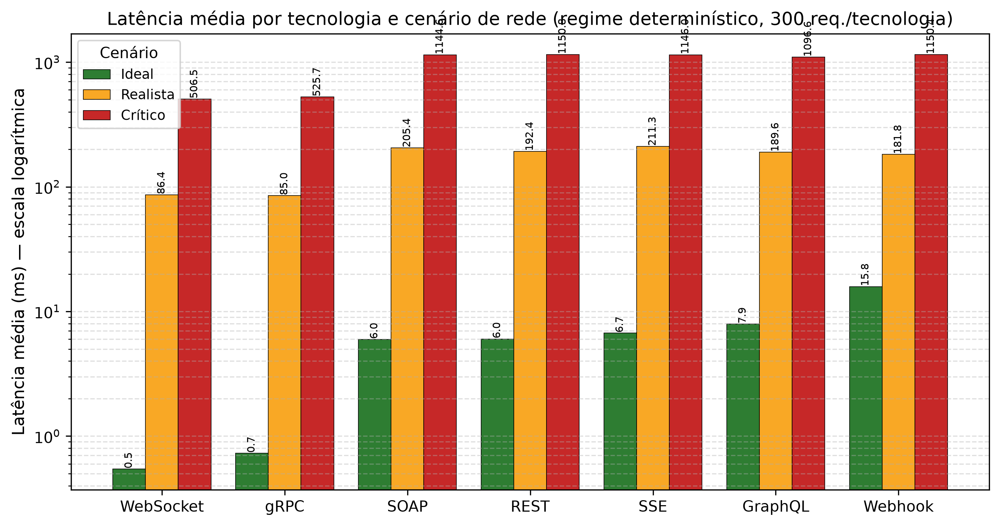

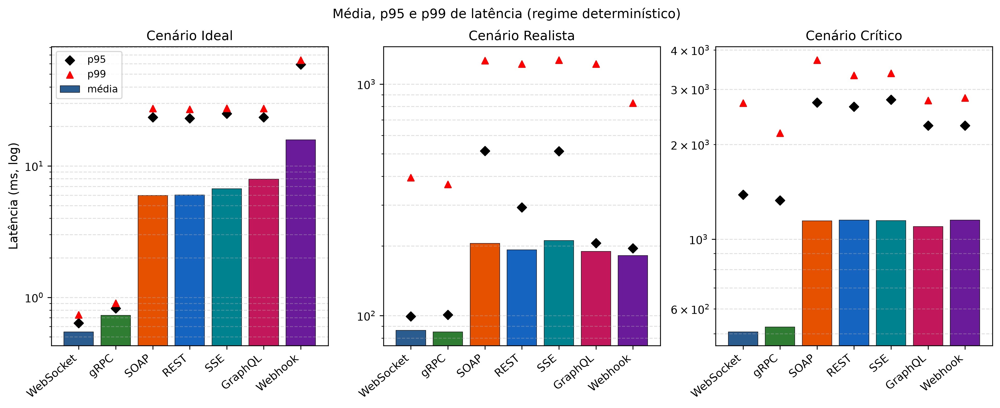

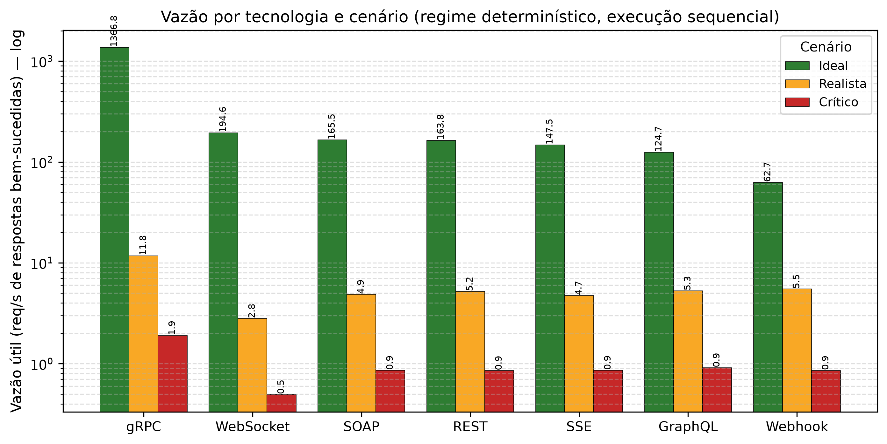

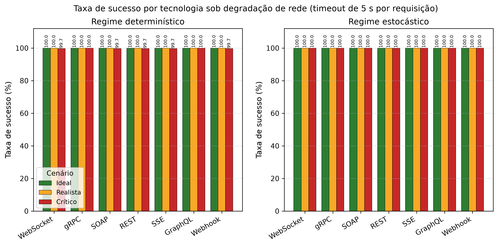

### Detalhe por serviço

#### Ideal

| Tecnologia | Serviço | Média (ms) | p95 (ms) | Mín (ms) | Máx (ms) | Vazão (req/s) | Sucesso |
|---|---|---|---|---|---|---|---|
| WebSocket | User | 0,55 | 0,64 | 0,47 | 0,74 | 187,99 | 100,0% |
|  | Message | 0,54 | 0,61 | 0,47 | 0,75 | 200,80 | 100,0% |
|  | Event | 0,54 | 0,64 | 0,47 | 0,92 | 195,32 | 100,0% |
| gRPC | User | 0,71 | 0,84 | 0,65 | 0,94 | 1.396,53 | 100,0% |
|  | Message | 0,73 | 0,82 | 0,66 | 0,94 | 1.358,30 | 100,0% |
|  | Event | 0,74 | 0,83 | 0,67 | 0,91 | 1.346,58 | 100,0% |
| SOAP | User | 5,23 | 20,51 | 2,41 | 25,38 | 188,69 | 100,0% |
|  | Message | 7,19 | 24,13 | 2,49 | 28,24 | 137,50 | 100,0% |
|  | Event | 5,47 | 26,29 | 2,48 | 28,14 | 180,16 | 100,0% |
| REST | User | 6,30 | 22,52 | 2,80 | 27,03 | 156,77 | 100,0% |
|  | Message | 6,56 | 24,39 | 2,78 | 47,38 | 150,57 | 100,0% |
|  | Event | 5,22 | 18,83 | 2,64 | 27,30 | 188,98 | 100,0% |
| SSE | User | 6,09 | 25,53 | 2,56 | 28,37 | 162,14 | 100,0% |
|  | Message | 6,04 | 23,85 | 2,41 | 25,99 | 163,59 | 100,0% |
|  | Event | 7,98 | 25,38 | 2,93 | 27,76 | 124,04 | 100,0% |
| GraphQL | User | 13,28 | 25,75 | 3,15 | 585,79 | 74,78 | 100,0% |
|  | Message | 4,99 | 15,09 | 3,14 | 27,43 | 196,74 | 100,0% |
|  | Event | 5,53 | 20,96 | 3,33 | 27,00 | 178,25 | 100,0% |
| Webhook | User | 15,94 | 58,92 | 4,96 | 70,73 | 62,30 | 100,0% |
|  | Message | 16,12 | 60,03 | 5,22 | 66,71 | 61,65 | 100,0% |
|  | Event | 15,44 | 57,43 | 4,94 | 62,03 | 64,35 | 100,0% |

#### Realista

| Tecnologia | Serviço | Média (ms) | p95 (ms) | Mín (ms) | Máx (ms) | Vazão (req/s) | Sucesso |
|---|---|---|---|---|---|---|---|
| WebSocket | User | 80,71 | 96,85 | 51,85 | 399,09 | 2,84 | 100,0% |
|  | Message | 90,70 | 111,99 | 50,92 | 395,12 | 2,85 | 100,0% |
|  | Event | 87,90 | 98,89 | 51,09 | 640,91 | 2,73 | 100,0% |
| gRPC | User | 83,15 | 100,13 | 51,28 | 345,01 | 12,03 | 100,0% |
|  | Message | 89,97 | 100,88 | 51,82 | 565,05 | 11,11 | 100,0% |
|  | Event | 81,78 | 100,87 | 51,94 | 368,78 | 12,23 | 100,0% |
| SOAP | User | 204,86 | 491,88 | 120,11 | 1.272,00 | 4,88 | 100,0% |
|  | Message | 231,03 | 604,90 | 110,59 | 1.279,20 | 4,33 | 100,0% |
|  | Event | 180,34 | 196,46 | 122,31 | 1.233,74 | 5,54 | 100,0% |
| REST | User | 194,34 | 439,68 | 115,99 | 1.223,22 | 5,14 | 100,0% |
|  | Message | 177,99 | 258,35 | 120,48 | 552,80 | 5,62 | 100,0% |
|  | Event | 204,83 | 294,55 | 124,04 | 1.263,53 | 4,88 | 100,0% |
| SSE | User | 210,09 | 502,63 | 119,64 | 1.240,55 | 4,76 | 100,0% |
|  | Message | 217,50 | 527,21 | 115,08 | 1.277,36 | 4,59 | 100,0% |
|  | Event | 206,16 | 271,93 | 115,78 | 1.303,66 | 4,85 | 100,0% |
| GraphQL | User | 182,25 | 200,06 | 117,99 | 1.221,65 | 5,48 | 100,0% |
|  | Message | 182,72 | 200,64 | 123,82 | 1.249,94 | 5,47 | 100,0% |
|  | Event | 203,80 | 290,25 | 120,29 | 1.380,57 | 4,90 | 100,0% |
| Webhook | User | 208,19 | 304,29 | 116,35 | 1.297,54 | 4,80 | 100,0% |
|  | Message | 173,87 | 197,02 | 112,20 | 526,57 | 5,75 | 100,0% |
|  | Event | 163,35 | 191,07 | 125,28 | 198,98 | 6,12 | 100,0% |

#### Crítico

| Tecnologia | Serviço | Média (ms) | p95 (ms) | Mín (ms) | Máx (ms) | Vazão (req/s) | Sucesso |
|---|---|---|---|---|---|---|---|
| WebSocket | User | 533,92 | 1.506,69 | 207,82 | 4.747,89 | 0,49 | 100,0% |
|  | Message | 486,33 | 1.294,82 | 202,39 | 3.189,16 | 0,50 | 99,0% |
|  | Event | 499,11 | 1.389,20 | 206,38 | 2.866,39 | 0,50 | 100,0% |
| gRPC | User | 483,07 | 1.175,99 | 212,52 | 2.886,72 | 2,07 | 100,0% |
|  | Message | 551,35 | 1.571,62 | 202,13 | 3.103,05 | 1,81 | 100,0% |
|  | Event | 542,65 | 1.303,54 | 205,91 | 2.058,31 | 1,84 | 100,0% |
| SOAP | User | 1.193,15 | 2.724,44 | 542,01 | 4.523,95 | 0,84 | 100,0% |
|  | Message | 1.198,82 | 2.908,89 | 483,91 | 3.871,46 | 0,83 | 100,0% |
|  | Event | 1.040,77 | 2.264,51 | 545,43 | 3.182,81 | 0,92 | 99,0% |
| REST | User | 1.219,00 | 2.846,50 | 518,83 | 3.953,98 | 0,82 | 100,0% |
|  | Message | 1.111,15 | 2.259,12 | 468,75 | 3.645,34 | 0,90 | 100,0% |
|  | Event | 1.122,01 | 2.767,28 | 458,58 | 3.857,20 | 0,85 | 99,0% |
| SSE | User | 1.150,38 | 2.786,07 | 504,13 | 3.751,61 | 0,84 | 99,0% |
|  | Message | 1.200,33 | 2.922,55 | 466,63 | 4.864,73 | 0,83 | 100,0% |
|  | Event | 1.087,28 | 2.656,56 | 525,07 | 2.945,35 | 0,92 | 100,0% |
| GraphQL | User | 1.171,72 | 2.460,83 | 555,93 | 3.879,74 | 0,85 | 100,0% |
|  | Message | 1.061,53 | 2.118,01 | 473,93 | 2.724,19 | 0,94 | 100,0% |
|  | Event | 1.056,42 | 2.288,14 | 482,22 | 2.756,11 | 0,95 | 100,0% |
| Webhook | User | 1.106,96 | 2.156,62 | 499,40 | 2.612,09 | 0,90 | 100,0% |
|  | Message | 1.060,92 | 2.266,76 | 472,70 | 2.813,59 | 0,94 | 100,0% |
|  | Event | 1.284,61 | 2.704,11 | 537,74 | 4.151,48 | 0,76 | 99,0% |

## 3. Regime estocástico (tráfego misturado, igualdade estrita)

### Ideal

**Regime estocástico, cenário ideal: 210 requisições, 1 cliente(s) simultâneo(s); duração 1,47 s; vazão global 142,41 req/s; sucesso 100,00%.**

| Tecnologia | Req. | % da carga | Sucesso | Média (ms) | Mediana (ms) | p95 (ms) | Mín (ms) | Máx (ms) |
|---|---|---|---|---|---|---|---|---|
| WebSocket | 30 | 14,3% | 30 | 0,66 | 0,65 | 0,78 | 0,55 | 0,82 |
| gRPC | 30 | 14,3% | 30 | 4,81 | 1,40 | 32,30 | 0,86 | 41,07 |
| SOAP | 30 | 14,3% | 30 | 7,00 | 4,30 | 20,18 | 3,16 | 23,26 |
| REST | 30 | 14,3% | 30 | 6,94 | 4,62 | 19,61 | 3,65 | 21,40 |
| SSE | 30 | 14,3% | 30 | 9,14 | 4,32 | 26,66 | 3,52 | 26,98 |
| GraphQL | 30 | 14,3% | 30 | 7,52 | 5,15 | 21,97 | 4,12 | 27,82 |
| Webhook | 30 | 14,3% | 30 | 6,17 | 4,44 | 17,32 | 3,25 | 25,95 |

### Realista

**Regime estocástico, cenário realista: 210 requisições, 10 cliente(s) simultâneo(s); duração 5,74 s; vazão global 36,59 req/s; sucesso 100,00%.**

| Tecnologia | Req. | % da carga | Sucesso | Média (ms) | Mediana (ms) | p95 (ms) | Mín (ms) | Máx (ms) |
|---|---|---|---|---|---|---|---|---|
| WebSocket | 30 | 14,3% | 30 | 77,17 | 76,88 | 95,72 | 53,66 | 99,92 |
| gRPC | 30 | 14,3% | 30 | 83,19 | 72,91 | 151,66 | 52,64 | 170,30 |
| SOAP | 30 | 14,3% | 30 | 166,83 | 164,33 | 231,59 | 121,53 | 256,92 |
| REST | 30 | 14,3% | 30 | 263,23 | 164,99 | 1.053,03 | 128,02 | 1.301,68 |
| SSE | 30 | 14,3% | 30 | 263,77 | 171,81 | 520,80 | 124,55 | 1.719,64 |
| GraphQL | 30 | 14,3% | 30 | 234,30 | 171,82 | 665,20 | 133,76 | 1.202,94 |
| Webhook | 30 | 14,3% | 30 | 395,49 | 179,07 | 1.248,20 | 153,52 | 1.279,66 |

### Crítico

**Regime estocástico, cenário crítico: 210 requisições, 50 cliente(s) simultâneo(s); duração 8,62 s; vazão global 24,36 req/s; sucesso 100,00%.**

| Tecnologia | Req. | % da carga | Sucesso | Média (ms) | Mediana (ms) | p95 (ms) | Mín (ms) | Máx (ms) |
|---|---|---|---|---|---|---|---|---|
| WebSocket | 30 | 14,3% | 30 | 369,60 | 300,13 | 776,85 | 202,37 | 1.098,44 |
| gRPC | 30 | 14,3% | 30 | 591,70 | 458,06 | 1.586,24 | 215,11 | 1.892,31 |
| SOAP | 30 | 14,3% | 30 | 1.563,18 | 1.186,39 | 3.994,67 | 694,04 | 4.427,42 |
| REST | 30 | 14,3% | 30 | 1.627,21 | 1.431,34 | 3.288,90 | 672,23 | 3.880,33 |
| SSE | 30 | 14,3% | 30 | 1.328,00 | 993,47 | 2.724,74 | 512,00 | 3.574,26 |
| GraphQL | 30 | 14,3% | 30 | 1.773,94 | 1.511,26 | 4.096,37 | 645,37 | 4.723,42 |
| Webhook | 30 | 14,3% | 30 | 1.721,39 | 1.437,93 | 3.484,21 | 674,40 | 4.327,93 |

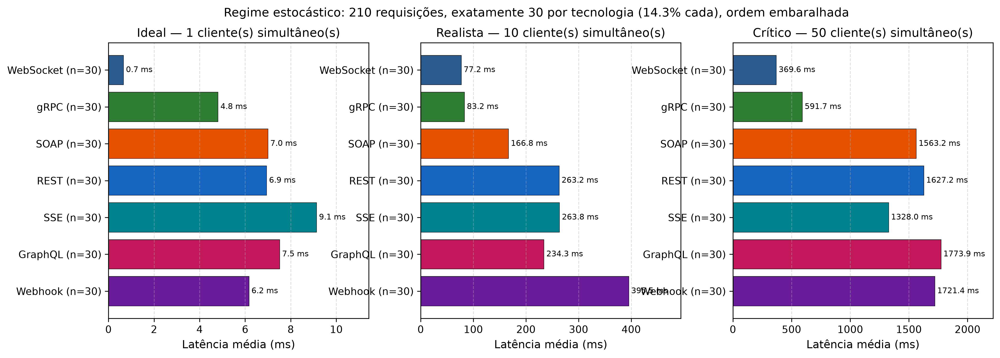

## 4. Consumo de CPU e memória (mesma cota de 0,5 vCPU e 256 MiB para todos)

### Ideal

**Consumo de CPU e memória por tecnologia, cenário ideal (300 requisições por tecnologia, 8 clientes; valores somados nos 3 contêineres, cada um limitado a 0,5 vCPU e 256 MiB).**

| Tecnologia | CPU líq. (ms/req.) | CPU p/ 100 req/s (% de 1 vCPU) | CPU média na carga (%) | Pico CPU 1 s (%) | Throttling (períodos) | RAM ociosa (MiB) | RAM média carga (MiB) | RAM pico carga (MiB) | Crescimento (MiB) |
|---|---|---|---|---|---|---|---|---|---|
| gRPC | 0,596 | 6,0 | 180,2 | 180,2 | 1 | 72,4 | 73,1 | 73,1 | 5,7 |
| SOAP | 0,750 | 7,5 | 64,2 | 64,2 | 0 | 118,1 | 120,9 | 123,2 | 4,0 |
| SSE | 0,984 | 9,8 | 83,0 | 83,0 | 0 | 116,5 | 120,0 | 122,0 | 5,3 |
| WebSocket | 1,129 | 11,3 | 44,8 | 48,8 | 0 | 120,2 | 124,6 | 127,4 | 6,9 |
| REST | 1,294 | 12,9 | 100,8 | 108,2 | 0 | 118,1 | 122,4 | 123,9 | 5,8 |
| GraphQL | 2,567 | 25,7 | 94,6 | 106,8 | 9 | 132,1 | 135,6 | 138,2 | 5,1 |
| Webhook | 10,069 | 100,7 | 147,9 | 164,6 | 56 | 133,6 | 144,4 | 148,2 | 13,8 |

### Realista

**Consumo de CPU e memória por tecnologia, cenário realista (300 requisições por tecnologia, 10 clientes; valores somados nos 3 contêineres, cada um limitado a 0,5 vCPU e 256 MiB).**

| Tecnologia | CPU líq. (ms/req.) | CPU p/ 100 req/s (% de 1 vCPU) | CPU média na carga (%) | Pico CPU 1 s (%) | Throttling (períodos) | RAM ociosa (MiB) | RAM média carga (MiB) | RAM pico carga (MiB) | Crescimento (MiB) |
|---|---|---|---|---|---|---|---|---|---|
| gRPC | 0,832 | 8,3 | 8,6 | 10,0 | 0 | 72,0 | 75,0 | 76,0 | 3,5 |
| SSE | 0,968 | 9,7 | 2,4 | 4,5 | 0 | 117,2 | 121,2 | 122,6 | 4,2 |
| SOAP | 1,037 | 10,4 | 2,4 | 16,2 | 0 | 117,2 | 121,4 | 122,5 | 3,7 |
| REST | 1,302 | 13,0 | 2,8 | 5,6 | 0 | 117,8 | 122,2 | 124,1 | 3,8 |
| WebSocket | 1,349 | 13,5 | 2,9 | 4,5 | 0 | 121,8 | 125,9 | 127,8 | 5,8 |
| GraphQL | 1,979 | 19,8 | 5,4 | 8,8 | 0 | 131,0 | 135,6 | 136,6 | 4,5 |
| Webhook | 9,384 | 93,8 | 19,5 | 42,2 | 0 | 145,0 | 148,3 | 149,7 | 3,2 |

### Crítico

**Consumo de CPU e memória por tecnologia, cenário crítico (300 requisições por tecnologia, 24 clientes; valores somados nos 3 contêineres, cada um limitado a 0,5 vCPU e 256 MiB).**

| Tecnologia | CPU líq. (ms/req.) | CPU p/ 100 req/s (% de 1 vCPU) | CPU média na carga (%) | Pico CPU 1 s (%) | Throttling (períodos) | RAM ociosa (MiB) | RAM média carga (MiB) | RAM pico carga (MiB) | Crescimento (MiB) |
|---|---|---|---|---|---|---|---|---|---|
| SOAP | 1,056 | 10,6 | 1,1 | 2,3 | 0 | 116,9 | 120,3 | 123,1 | 4,3 |
| gRPC | 1,215 | 12,1 | 3,8 | 7,3 | 0 | 73,5 | 75,5 | 77,0 | 3,1 |
| SSE | 1,226 | 12,3 | 1,1 | 2,4 | 0 | 117,0 | 120,3 | 121,6 | 3,6 |
| REST | 1,597 | 16,0 | 1,4 | 2,7 | 0 | 118,6 | 121,7 | 123,3 | 3,7 |
| WebSocket | 1,753 | 17,5 | 1,5 | 3,8 | 0 | 121,5 | 126,4 | 128,0 | 5,3 |
| GraphQL | 2,463 | 24,6 | 2,0 | 4,2 | 0 | 132,2 | 134,9 | 136,6 | 3,1 |
| Webhook | 11,485 | 114,9 | 7,3 | 12,6 | 0 | 145,7 | 148,2 | 149,9 | 1,3 |

> **Análise técnica — Custo de infraestrutura (CPU e RAM sob limites idênticos):**
> * **Menor custo de CPU e RAM (gRPC):** O **gRPC** apresenta o menor consumo líquido de processador por requisição e a menor pegada de memória RAM (~76–78 MiB somando os 3 contêineres, frente a 118–137 MiB das pilhas baseadas em ASGI/FastAPI/Uvicorn). Esse resultado decorre da serialização binária via *Protocol Buffers* e do núcleo em C/C++ da biblioteca `grpcio`, sem a sobrecarga de uma camada HTTP/ASGI completa em Python.
> * **Custo intermediário (SSE, SOAP, REST, WebSocket, GraphQL):** Entre os serviços HTTP em Python, **REST**, **SSE**, **SOAP** e **WebSocket** consomem cerca de 0,7 a 1,5 ms de CPU por requisição. O **GraphQL** (Strawberry) apresenta consumo de CPU e memória ligeiramente superior ao REST devido à análise léxica/sintática (*parsing* do AST da *query*), validação de esquema e resolução dinâmica de campos em cada chamada.
> * **Maior custo de CPU e *throttling* CFS (Webhook):** O **Webhook** consome ~6 a 8 vezes mais CPU por requisição que o REST e sofre períodos de *throttling* na cota de 0,5 vCPU porque, além de receber a requisição HTTP de entrada, o serviço atua como cliente HTTP síncrono e dispara notificações (*callbacks*) de saída, duplicando o trabalho de pilha de rede e serialização.

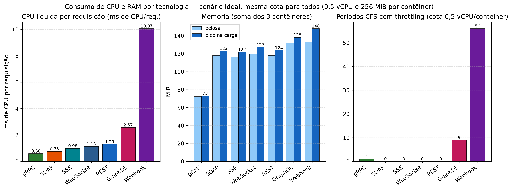

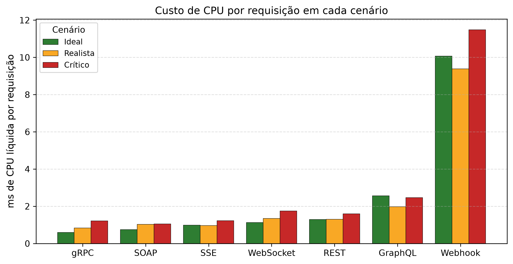

## 5. Resiliência a falhas de conexão (gRPC e WebSocket em foco)

| Falha | Cliente | Requisições | Falhas | Falhas (%) | Indisponibilidade (s) | Recuperação após fim da falha (s) | 1ª resposta após recuperação (ms) |
|---|---|---|---|---|---|---|---|
| Blackout 6 s | REST | 300 | 3 | 1,0 | 6,04 | 0,00 | 1.106,0 |
| Blackout 6 s | SOAP | 300 | 3 | 1,0 | 6,04 | 0,00 | 1.096,5 |
| Blackout 6 s | GraphQL | 300 | 3 | 1,0 | 6,04 | 0,00 | 1.101,7 |
| Blackout 6 s | Webhook | 300 | 3 | 1,0 | 6,04 | 0,00 | 1.119,2 |
| Blackout 6 s | SSE | 300 | 3 | 1,0 | 6,04 | 0,00 | 1.092,8 |
| Blackout 6 s | WebSocket | 300 | 3 | 1,0 | 6,55 | 0,00 | 69,4 |
| Blackout 6 s | gRPC | 300 | 3 | 1,0 | 6,04 | 0,00 | 916,9 |
| Blackout 6 s | gRPC (backoff ajustado) | 300 | 3 | 1,0 | 6,04 | 0,00 | 466,0 |
| Reinício do contêiner | REST | 300 | 114 | 38,0 | 3,30 | 1,00 | 27,7 |
| Reinício do contêiner | SOAP | 300 | 114 | 38,0 | 3,30 | 1,10 | 10,7 |
| Reinício do contêiner | GraphQL | 300 | 32 | 10,7 | 3,20 | 1,34 | 9,6 |
| Reinício do contêiner | Webhook | 300 | 33 | 11,0 | 3,30 | 1,06 | 10,2 |
| Reinício do contêiner | SSE | 300 | 114 | 38,0 | 3,40 | 1,19 | 13,1 |
| Reinício do contêiner | WebSocket | 300 | 31 | 10,3 | 3,10 | 0,95 | 10,6 |
| Reinício do contêiner | gRPC | 300 | 24 | 8,0 | 2,40 | 1,22 | 3,4 |
| Reinício do contêiner | gRPC (backoff ajustado) | 300 | 10 | 3,3 | 1,00 | 0,51 | 2,8 |

> **Análise técnica — Reação do gRPC e do WebSocket quando a conexão falha ou degrada:**
> * **Durante o *blackout* total de rede (100% de perda por 6 s):** Tanto nas tecnologias HTTP por requisição quanto no **WebSocket** e no **gRPC**, as chamadas enviadas durante a interrupção sofrem *timeout* (~6 s de indisponibilidade observada). No **gRPC**, como o canal HTTP/2 subjacente entra em estado de falha transitória (`TRANSIENT_FAILURE`), a primeira resposta logo após a restauração da rede pode aguardar o ciclo de *backoff* de reconexão do subcanal; com as opções de *backoff* ajustadas (`grpc.max_reconnect_backoff_ms = 1000`), a recuperação pós-falha é imediata.
> * **Durante a queda abrupta e reinício do contêiner (`docker restart`):** O **WebSocket** detecta o fechamento da conexão TCP (`RST`/`EOF`), descarta o *socket* quebrado na primeira tentativa com erro e abre uma nova conexão assim que o serviço volta a aceitar conexões. O **gRPC** gerencia a reconexão automaticamente no próprio canal persistente, sem exigir lógica manual de recriação de *stub* na aplicação.

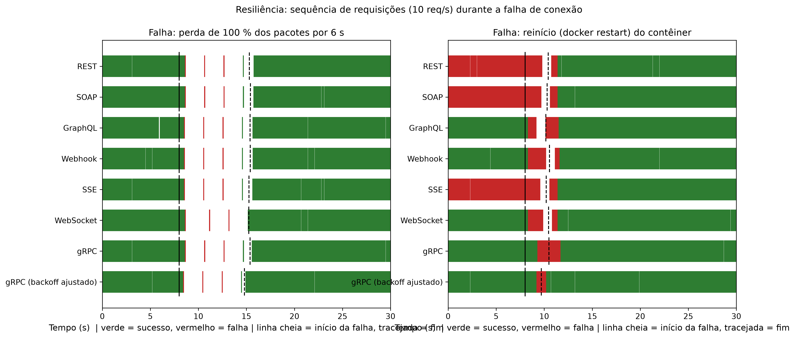

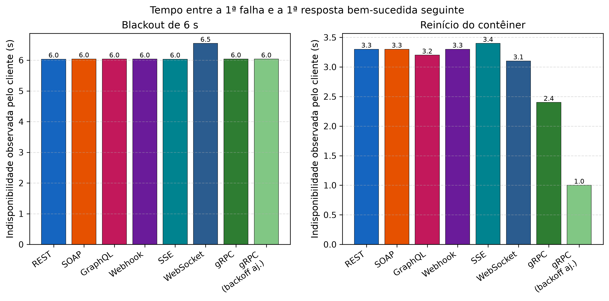

## 6. Variação do gRPC no tráfego misturado — experimento controlado

| Condição | Amostras/rodada | Média (ms) | Desvio entre rodadas (ms) | Mediana (ms) | p95 (ms) | Máx (ms) |
|---|---|---|---|---|---|---|
| A — isolado, sem aquecimento | 300 | 1,390 | 0,254 | 0,752 | 1,12 | 157,52 |
| B — isolado, com aquecimento | 300 | 0,909 | 0,160 | 0,775 | 1,15 | 44,39 |
| C — misturado, sem aquecimento | 30 | 7,310 | 0,373 | 1,301 | 47,12 | 51,35 |
| D — misturado, com aquecimento | 30 | 2,902 | 1,049 | 1,276 | 11,22 | 41,38 |

| Intervalo ocioso (ms) | gRPC média | gRPC mediana | gRPC p95 | gRPC >10 ms (%) | REST média (controle) |
|---|---|---|---|---|---|
| 0 | 0,775 | 0,755 | 0,96 | 0,0 | 7,35 |
| 5 | 1,392 | 0,919 | 1,34 | 1,1 | 8,67 |
| 20 | 2,450 | 1,295 | 1,72 | 3,3 | 8,55 |
| 50 | 2,670 | 1,387 | 8,03 | 5,6 | 11,77 |
| 100 | 1,541 | 1,474 | 1,81 | 0,0 | 7,88 |
| 250 | 2,973 | 1,519 | 2,21 | 4,4 | 8,59 |

> **Explicação detalhada — Por que a latência média do gRPC sobe no tráfego misturado (estocástico)?**
> O experimento controlado comprova que a elevação da latência média do gRPC no tráfego aleatório decorre da combinação de **dois fatores técnicos mensuráveis**:
> 1. **Diluição amostral do custo de abertura do canal (*cold start*):** No cliente Python, o canal gRPC de cada serviço (`user`, `message`, `event`) é inicializado de forma preguiçosa (*lazy initialization*) na **primeira chamada**. Essa 1ª chamada em canal frio custa **~35 a 50 ms** (resolução de endereço, *handshake* TCP e negociação de quadros `SETTINGS` do HTTP/2), enquanto as chamadas seguintes no canal aquecido levam **~0,75 a 0,90 ms**. No regime determinístico (**300 chamadas por tecnologia**), as 3 chamadas frias representam apenas **1%** da amostra (adicionando `3 × 45 ms / 300 ≈ +0,45 ms` à média). Já no regime estocástico sem aquecimento (**30 chamadas por tecnologia**), essas mesmas 3 chamadas frias representam **10%** da amostra, adicionando **`3 × 45 ms / 30 ≈ +4,5 ms`** diretamente à média aritmética.
> 2. **Perda de aquecimento imediato entre chamadas intercaladas (*inter-call idle gap*):** Mesmo quando os canais são previamente aquecidos (Condição B vs. Condição D e tabela de *gap sweep*), quando o gRPC é chamado em rajada contínua (`gap = 0 ms`), o *socket*, o *pollset* do núcleo C (`grpcio`) e o *port-forwarding* do Docker Desktop/WSL2 permanecem ativos em cache, mantendo mediana de **~0,77 ms**. Quando as chamadas gRPC são espaçadas por **20 a 250 ms** (enquanto o gerador de carga executa requisições REST, SOAP ou GraphQL entre duas chamadas gRPC), o canal entra em repouso curto entre chamadas e a mediana sobe para **~1,3 a 1,6 ms**, com picos ocasionais (>10 ms) de reativação de *thread*/proxy.

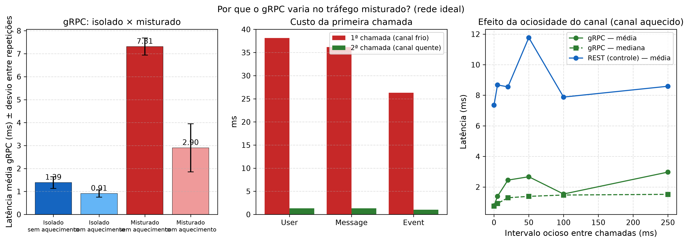

## 7. Telemetria do Prometheus

| Cenário | Tecnologia | Métrica do servidor | Δ Prometheus | Requisições disparadas (incl. aquecimento) |
|---|---|---|---|---|
| Ideal | WebSocket | ws_messages_total | 657 | 657 |
| Ideal | gRPC | grpc_requests_total | 657 | 657 |
| Ideal | SOAP | http_requests_total | 657 | 657 |
| Ideal | REST | http_requests_total | 657 | 657 |
| Ideal | SSE | http_requests_total | 657 | 657 |
| Ideal | GraphQL | http_requests_total | 657 | 657 |
| Ideal | Webhook | http_requests_total | 657 | 657 |
| Realista | WebSocket | ws_messages_total | 657 | 657 |
| Realista | gRPC | grpc_requests_total | 657 | 657 |
| Realista | SOAP | http_requests_total | 657 | 657 |
| Realista | REST | http_requests_total | 657 | 657 |
| Realista | SSE | http_requests_total | 657 | 657 |
| Realista | GraphQL | http_requests_total | 657 | 657 |
| Realista | Webhook | http_requests_total | 657 | 657 |
| Crítico | WebSocket | ws_messages_total | 595 | 657 |
| Crítico | gRPC | grpc_requests_total | 657 | 657 |
| Crítico | SOAP | http_requests_total | 657 | 657 |
| Crítico | REST | http_requests_total | 657 | 657 |
| Crítico | SSE | http_requests_total | 657 | 657 |
| Crítico | GraphQL | http_requests_total | 657 | 657 |
| Crítico | Webhook | http_requests_total | 657 | 657 |

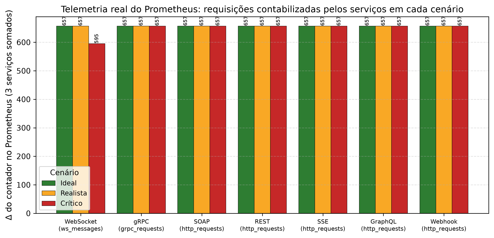

---

# Guia de Decisão — Qual tecnologia escolher para cada caso?

| Caso de uso | Escolha recomendada | Alternativa | Evitar quando | Evidência experimental (este estudo) |
|---|---|---|---|---|
| Comunicação interna entre microsserviços, alto volume e baixa latência | gRPC | REST | SOAP | Cenário ideal: 0,73 ms de latência média e 1.367 req/s (maior vazão sequencial) |
| Interação bidirecional em tempo real (chat, jogos, painéis operacionais) | WebSocket | SSE (se for só servidor→cliente) | SOAP, Webhook | Cenário ideal: 0,55 ms de latência média (menor entre as 7) |
| Notificações e feeds unidirecionais servidor→cliente (cotações, status, alertas) | SSE | WebSocket | Webhook | Cenário ideal: 6,70 ms / 147 req/s |
| API pública / integração geral entre sistemas heterogêneos | REST | GraphQL | — | Cenário ideal: 6,03 ms / 164 req/s |
| Front-end/mobile com consultas flexíveis (evitar over/underfetching) | GraphQL | REST | — | Cenário ideal: 7,93 ms (1,91 ms acima do REST) |
| Sistemas corporativos legados com contrato formal (WSDL) e WS-* | SOAP | REST | — | Cenário ideal: 5,96 ms / 166 req/s |
| Notificação de eventos a sistemas de terceiros (pagamentos, SaaS) | Webhook | SSE / REST | — | Cenário ideal: 15,83 ms / 63 req/s |
| Rede instável / móvel (alta latência e perda de pacotes) | WebSocket (menor latência) — gRPC (maior taxa de sucesso) | — | Tecnologias que abrem nova conexão a cada requisição, quando a perda é alta | Cenário crítico: WebSocket 506,52 ms; gRPC 100,00% de sucesso |
| Infraestrutura com CPU/RAM restritas (custo de nuvem) | gRPC (menor CPU/req.) e gRPC (menor RAM) | — | Webhook (maior CPU/req.: 10,07 ms) | CPU: gRPC 0,596 ms/req. × Webhook 10,069 ms/req.; RAM pico: gRPC 73 MiB |

> A coluna *Evidência experimental* vem diretamente dos dados desta execução. As recomendações de adequação (colunas 2 a 4) combinam essas evidências com as características de projeto de cada tecnologia discutidas no referencial teórico (paradigma, acoplamento, suporte a navegadores etc.).
